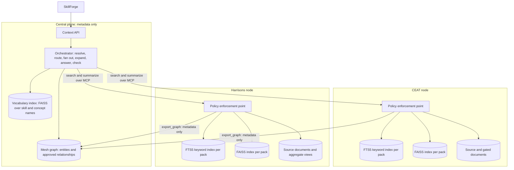
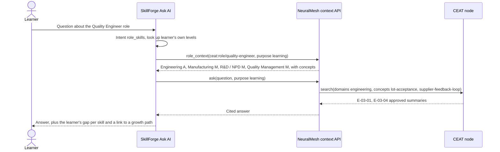

# RPG NeuralMesh: Knowledge Mesh Strategy and SkillForge Context Plan

## 1. Strategy Summary and Key Decisions

NeuralMesh becomes the group's knowledge mesh. Each subsidiary keeps its knowledge inside its own Mesh Node (the subsidiary's MCP server) as knowledge packs, one pack per domain, each searched by keyword and by meaning. A central mesh graph connects subsidiaries, domains, documents, concepts, skills, roles and experts, using metadata only. SkillForge, the group's learning, assessment and skills platform, calls NeuralMesh for this context in three user journeys: questions about the skills a job needs, CV updates with suggested positions, and learning the skills a position needs.

MCP (Model Context Protocol) is the open protocol the four existing nodes already use to offer tools to the central orchestrator.

**Key decisions**

1. **Two layers.** Document text, text chunks and their vectors stay inside the subsidiary's node. The central mesh graph holds only what the metadata-only exposure mode (MD) already allows: IDs, titles, tags, owners, concepts, skills, roles, consented experts without names, and approved relationships.
2. **One JSON format for providing knowledge.** A knowledge pack holds the knowledge of one subsidiary for one domain, or group-wide vocabulary and links. The format is a JSON Schema in `planning_docs/knowledge_pack_format/`, with a validator and four example packs built from the existing synthetic data.
3. **Eight domains.** Seven follow the catalogue groups of the design plan: engineering (E), operations (O), commercial (C), research (R), corporate functions (F), lessons learned (L) and mesh meta-data (M). The eighth, talent, holds the expert directory and job roles with their required skills. The four pilot nodes split into 19 packs.
4. **FAISS vector search at each node, combined with the existing keyword search.** FAISS is Meta's open-source library for searching vectors. Each pack gets its own FAISS index next to the SQLite FTS5 keyword index the nodes use today. The two result lists are merged by reciprocal rank fusion, which scores each document by its rank in each list and adds the scores. Only text that may leave the node in the document's exposure mode is turned into vectors.
5. **Graph store.** The mesh graph starts as two SQLite tables (entities and relationships) in the central registry, behind a store interface. Neo4j is the target when the graph passes 1 million relationships, when the user interface needs paths of three or more steps, or when more than one service writes to the graph. Kùzu is not used, because its repository was archived in October 2025.
6. **Relationships between subsidiaries need both owners.** A relationship that joins two subsidiaries is written only in a group links pack, and it is used in answers only after the owner role of each side has approved it. A relationship proposed by an extraction job starts as "proposed".
7. **Clear ownership with SkillForge.** SkillForge stays the system of record for people, skill levels, tests, openings, growth paths and consent. NeuralMesh is the system of record for knowledge and how it connects. The shared keys are SkillForge's group skill (`group_skills.name_key`) and job role.
8. **Two new purposes.** `learning` and `career_mobility` join the three purposes nodes accept today (`problem_solving`, `compliance`, `bid_support`). Each datapoint owner decides whether its documents may be used for them.
9. **CV text never leaves SkillForge.** SkillForge resolves CV phrases against a copy of the group vocabulary. A skill found in a CV enters SkillForge as self-reported (trust rank 5). It ranks suggestions for the employee but fills no HR shortlist until a test confirms it.
10. **Study material from another subsidiary is shown by reference.** The learner reads it at the time of study, fetched from the owning node, and nothing is copied. A copy into SkillForge needs the owner's time-limited learning release.

**Phases**

| Phase | Scope | Main deliverable | Exit test | Effort estimate |
|---|---|---|---|---|
| 0 | Clean the base | One node registry file in place of five hard-coded node lists, fixed inconsistencies | A new node needs only a registry entry and a pack, all 38 existing tests pass | 1 week |
| 1 | Knowledge packs and hybrid search at the nodes | Converter, loader with all format rules, a FAISS index per pack | All 10 golden scenarios pass, recall on reworded questions beats keyword search alone, no canary in any index | 3 weeks |
| 2 | Central mesh graph, routing and link approvals | `export_graph` tool, graph store, vocabulary and links packs, approvals in the Governance page | Routing picks every expected node in 10 of 10 golden scenarios with no node chosen by the user | 3 weeks |
| 3 | Answers written from the evidence, with citations | Answer and check steps in the LangGraph orchestrator | Every answer sentence cites a returned item, blocked scenarios S5 and S6 stay blocked, median answer time under 10 seconds | 2 weeks |
| 4 | SkillForge context API and the three journeys | Six context tools, talent packs, journeys A, B and C in SkillForge | Acceptance tests of section 6, no CV text in any NeuralMesh log | 4 weeks |
| 5 | Scale | Wave 2 nodes, link extraction, Neo4j when a trigger is reached, Entra ID (Microsoft's corporate sign-in) in place of the development secret | Set per wave | Ongoing |

The effort column assumes a team of two engineers (one on NeuralMesh search and graph, one on SkillForge and the user interface), 13 weeks for phases 0 to 4. These are planning estimates. Phase 1 progress replaces them with measured figures.

## 2. Analysis of the Current NeuralMesh Project

### 2.1 What Works in the Repository Today

| Area | What exists | Where |
|---|---|---|
| Subsidiary nodes | Four MCP servers: CEAT on port 8101, KEC 8102, Zensar 8103, Harrisons Malayalam 8104. Each offers six tools: `health`, `describe_capabilities`, `search`, `summarize`, `find_experts`, `request_access` | `app/mcp_nodes/server.py` |
| Policy at the node | The policy enforcement point (PEP) checks caller role and purpose, the exposure ceiling, never-leave rules, approval needs and the results blackout calendar, and returns a decision code with a rule ID. The ceiling is the most a datapoint may reveal: MD metadata only, SUM the owner-approved summary, RAG cited text chunks, LIVE the result of an allow-listed query | `app/mcp_nodes/policy.py` |
| Keyword search | SQLite FTS5 full-text search ranked by BM25 (the standard keyword relevance formula) over a read-only index that holds only text allowed to leave the node | `app/mcp_nodes/server.py`, `search_node` |
| Approvals and audit | Content and expert-introduction requests, grants of up to 168 hours (7 days) that can be revoked, a hash-chained audit log of decisions with no content | `app/mcp_nodes/access_store.py`, `approvals.py` |
| Synthetic knowledge | 46 documents, 28 datapoints (9 CEAT, 11 KEC, 4 Zensar, 4 Harrisons), 18 experts of whom 4 opted out, 8 canary strings (unique strings planted in restricted text, so that finding one outside the node proves a leak), 3 structured databases with aggregate views, 25 gold facts (numbers computed from the data that a correct answer must contain) and 10 golden scenarios (test questions S1 to S10 with expected citations and refusals) | `app/neuralmesh_kb_pack/` |
| Orchestrator | A LangGraph graph (LangGraph is a library for building agent workflows as graphs of steps) with two steps: `fan_out` calls the selected nodes in parallel and `assemble` merges sources, withheld items and node status | `app/services/neuralmesh.py` |
| API and screens | `POST /api/v1/mesh/query` and endpoints for nodes, experts and approvals. React pages Dashboard, Ask, Expert Finder, Mesh Nodes, Governance, Admin, Playground and Settings | `app/api/routers/mesh.py`, `app/ui/src/pages/` |
| Tests | 38 test functions in 5 files | `app/tests/` |

The policy model is the strongest part of the project and the plan keeps it unchanged: policy is decided at the node, metadata first and content on approval, every claim cited, and the audit stores decisions, never content.

### 2.2 Gaps Between Today and a Knowledge Mesh

| Gap | Effect today | Closed by |
|---|---|---|
| No relationships between knowledge items. Links such as "KEC E-05-01 supports CEAT E-03-05" exist only as sentences in the planning documents and gold facts | An answer shows corroboration, conflict or a gap only when the keywords happen to find both documents | Relationships in packs and the group links pack (section 3.3) |
| Keyword search only | "Latex going bad before it reaches the factory" does not find documents that say "pre-coagulation" | FAISS search combined with FTS5 (section 3.4) |
| The user picks the nodes. `nodes` is a required field of the query request | A user who does not know which subsidiary holds the answer gets none | Routing through the mesh graph (section 3.6) |
| No shared vocabulary. The design plan names an "MCP registry and ontology" (table A2, row 3), and no code exists for it | CEAT's "lot acceptance" and a Harrisons term for the same check are unrelated words | Group vocabulary pack (section 4) |
| No written answer. The `answer` field is always empty and the Ask page shows evidence and citations only | The user reads and joins the evidence alone | Phase 3 |
| The list of nodes is written in five places: `services/neuralmesh.py`, `mcp_nodes/server.py`, `api/schemas/mesh.py`, `api/schemas/auth.py` and `kbgen.py` | Adding RPG Life Sciences changes code in five files | Node registry file (phase 0) |
| Knowledge is written as YAML per node, read by one generator script | Other teams have no published format to supply knowledge | JSON knowledge pack format (section 4) |
| Expert search counts the words shared between the query and an expert's role and skills | "Vendor quality" finds nobody, though CE-1 is a supplier quality lead | Expert search through concepts and evidence documents (section 3.7) |
| Parts of the accelerator template are unused: Qdrant settings, the Azure OpenAI factory, the Temporal worker, Postgres in `docker-compose.yml`, and placeholder names such as `__APP_TITLE__` in `api/main.py`, `docker-compose.yml` and `ui/package.json` | The deployment files do not describe the running system | Phase 0 keeps or removes each part |
| Start commands are written for Windows PowerShell only | Team members on macOS or Linux translate each command | Phase 0 |

### 2.3 Inconsistencies Between the Repository Files

- **KEC delay share.** The MCP server plan (sections 1 and 5.1) gives material-supply delays as 31% of delay notes. The data in `projects.db` has 25 of 90 delay notes in that category, which is 28%, and gold fact K4 also says 28%.
- **Harrisons SOP ceiling.** The MCP server plan (section 3.1) gives the F-01 estate SOPs a RAG ceiling. `kb/harrisons.yaml` gives SUM, which matches the design plan (table C2: "SUM at L1 nodes such as Harrisons"). The MCP server plan is the outdated one.
- **Missing files.** The MCP server plan refers to `RPG_NeuralMesh_Implementation_Blueprint.md` and the design plan to `RPG_NeuralMesh_POC_Consistency_Audit.md`. Neither file is in the repository.
- **Company lists.** SkillForge seeds seven companies, Asvata among them, and has no RPG Ventures. The NeuralMesh design plan lists RPG Ventures as a lite node (a managed node bundle for a unit with little IT staff) and does not name Asvata. The subsidiary list of the knowledge pack format holds both.

### 2.4 What SkillForge Already Offers

These facts come from the SkillForge repository (`test-maker-skillforge`).

- **Skills tables in SQL.** `skills`, `group_skills` (one entry for each skill across companies, so a level held under one company's name counts for another company's opening), `job_roles`, `role_skill_requirements` (required level L beginner, M intermediate or A advanced), `topics`, `topic_skills` and `employee_skills` with the source of each level and its trust rank. Trust ranks run from 1 (certification exam or checked certificate) through 2 (calibre test, SkillForge's placement test, or a timed exam), 3 (training quiz or a test past its validity), 4 (manager attestation) and 5 (self-reported) to 6 (test not passed). Ranks 1 and 2 count as verified.
- **A graph that nothing reads.** The tables `kg_entities` and `kg_relationships` mirror roles, skills and topics with the relations "requires" and "covers_skill", and no answer path reads them.
- **Curriculum map.** 7 companies, 17 roles, 71 topics (35 company topics and 36 certification exam topics) and 57 role requirements.
- **Vector store.** One Chroma collection, chunks of 1,200 characters with 120 characters of overlap, companies kept apart by an `org_id` field on each chunk, and the local embedding model all-MiniLM-L6-v2 or Azure text-embedding-3-small.
- **Ask AI.** `POST /api/v1/rag/chat` answers from the learner's own company content. Its intent classifier knows five intents (exam rules, content, catalogue, progress, chitchat) and none about jobs or skills.
- **Openings.** Matching is rule-based: the share of an opening's required skills that a person holds at the required level from a source at least as trusted as the opening accepts. The shortlist starts at 0.6 by default and a near miss at 0.4.
- **Growth paths.** A path uses topics of the employee's own company only. A required skill with no covering topic is marked `no_content`. Only 9 of the 41 skills that roles require have a test, and a topic counts as tested at 10 approved exam questions.
- **No CV feature.** No CV or resume upload, parsing or skill extraction exists. The nearest parts are self-reported skills (trust rank 5), the Skill Mapper (proposes up to 15 skills from free text, and code checks the output) and the document parsers for PDF, DOCX, HTML and images.

## 3. Target Design of the Knowledge Mesh

### 3.1 Two Layers: Knowledge Stays at the Node, Connections Live at the Centre



| Item | Kept at the node | Kept at the centre | Kept in SkillForge |
|---|---|---|---|
| Document bodies, chunks and their vectors | Yes | No | No |
| Approved summaries | Yes, sent per query when policy allows | No | Only under a learning release |
| Document ID, title, tags, datapoint and owner role | Yes | Yes, unless the datapoint is marked hidden | No |
| Concepts, skills and domains | No | Yes, in the group vocabulary pack | A read-only copy for resolving CV phrases |
| Job roles and required skills | No | A read-only copy in the talent packs | Yes, the source |
| Experts | Consented and opted-out records, with names | Consented experts with role, skills and evidence IDs, no names | No |
| Relationships inside one subsidiary | Written in the node's packs | Copied through `export_graph` | No |
| Relationships between subsidiaries | No | Yes, the group links pack | No |
| Employee levels, CVs, openings, growth paths, consent records | No | No | Yes |

### 3.2 Domains and Knowledge Packs

| Domain ID | Catalogue code | Pilot datapoints | Example of what it answers |
|---|---|---|---|
| `engineering` | E | E-01 to E-05 | Which material handling practices reduce failures linked to storage |
| `operations` | O | O-01, O-02, O-05, O-06 | Which delays and breakdowns repeat across plants and projects |
| `commercial` | C | C-01, C-02, C-03, C-05 | Which contract clauses led to claims |
| `research` | R | R-02 | What AI-assisted testing pilots found |
| `corporate` | F | F-01, F-02, F-05, F-06 | What the estate SOPs say about monsoon collection |
| `lessons` | L | L-01, L-02, L-02a | What went wrong in the first 100 days of an acquisition |
| `mesh` | M | M-01 to M-04 (catalogue, policies, audit decisions, feedback) | Which nodes are live and which datapoints they offer |
| `talent` | F-04, T-01 | Expert directory, job roles and required skills | What a Quality Engineer at CEAT needs |

F-04 keeps its catalogue code and moves to the talent domain. T-01 is a new catalogue code for job roles and required skills, copied from SkillForge.

A pack is named `<subsidiary>.<domain>`, for example `ceat.engineering`. The four pilot nodes give 19 packs: 6 for CEAT, 6 for KEC, 4 for Zensar and 3 for Harrisons. The largest, `ceat.engineering`, has 10 documents. Five packs have no documents yet: the four talent packs (experts only, until roles are imported) and `kec.corporate` (the ESG aggregate view only).

Packs per domain bring three gains. Routing searches only the domains the graph links to a question. An owner can publish, pause or rebuild one domain without touching the others. Each domain keeps its own refresh cycle, for example seasonal for Harrisons O-05 and weekly for KEC O-06.

### 3.3 Entities and Relationships of the Mesh Graph

The "nodes and edges" of the knowledge graph are called entities and relationships here, because "node" already means a subsidiary's MCP server in NeuralMesh.

**Entity types (9)**

| Type | ID pattern | Example | Written by |
|---|---|---|---|
| Subsidiary | `org:<id>` | `org:harrisons` | Mesh team |
| Domain | `domain:<id>` | `domain:engineering` | Mesh team |
| Datapoint | `<subsidiary>:<code>` | `ceat:E-03` | Datapoint owner |
| Document | `<subsidiary>:<code>-<number>` | `ceat:E-03-01` | Datapoint owner |
| Concept | `concept:<name>` | `concept:lot-quality-trending` | Mesh knowledge curator |
| Skill | `skill:<SkillForge name key with hyphens>` | `skill:quality-management` | Group HR in SkillForge |
| Role | `<subsidiary>:role/<name>` | `ceat:role/quality-engineer` | Company HR in SkillForge |
| Expert | `<subsidiary>:expert/<id>` | `ceat:expert/CE-1` | CHRO of the subsidiary |
| Asset | `<subsidiary>:asset/<name>` | `ceat:asset/mixer-line` | Plant or site owner |

A concept is a unit of knowledge (lot traceability, latex pre-coagulation). A skill is a unit that SkillForge tests and records levels for (Quality Management, Manufacturing). SkillForge skills are broad, so many concepts belong to one skill.

**Relationship types written in packs (15)**

| Type | From and to | Meaning | Example from the synthetic data |
|---|---|---|---|
| MENTIONS | Document to Concept or Asset | The document is about the concept | `ceat:E-03-05` to `concept:time-to-use-limit` |
| EXPLAINS_SKILL | Document to Skill, with a level | The document can serve as study material for the skill up to that level | `ceat:E-03-01` to `skill:quality-management`, level M |
| PART_OF_SKILL | Concept to Skill | The concept is part of what the skill covers | `concept:lot-traceability` to `skill:manufacturing` |
| BROADER | Concept to Concept, Skill to Skill | The first is a narrower form of the second | `concept:lot-acceptance` to `concept:incoming-quality-control` |
| RELATED_TO | Concept and Concept, Skill and Skill, either direction | Close in meaning, neither contains the other | `concept:latex-collection-and-transport` and `concept:time-to-use-limit` |
| SAME_AS | Concept and Concept, Skill and Skill, either direction | Two names for one thing, usually from two subsidiaries | A subsidiary's own name for lot acceptance and `concept:lot-acceptance` |
| CORROBORATES | Document to Document | The first gives evidence that supports the second | `kec:E-05-01` (elastomers age faster when stored warm or long) to `ceat:E-03-05` (time-to-use limits) |
| CONFLICTS_WITH | Document and Document, either direction | The two give opposite advice | `ceat:L-01-01` (integrate systems early) and `zensar:C-05-01` (stabilise processes before cut-over) |
| SUPERSEDES | Document to Document | The first replaces the second | `ceat:E-03-02` to `ceat:E-03-06` (the 2019 note) |
| ADDRESSES_GAP | Document to Document | A practice in the first answers a gap stated in the second | `ceat:E-03-01` (lot trending at receipt) to `harrisons:O-05-04` (no lot-level trending at receipt) |
| REQUIRES_SKILL | Role to Skill, with level and importance | The role needs the skill at that level | `ceat:role/quality-engineer` to `skill:engineering`, level A |
| PREREQUISITE_OF | Skill to Skill | Learn the first before the second | Copied from SkillForge's topic prerequisites |
| HAS_SKILL | Expert to Skill | The consented expert holds the skill | `ceat:expert/CE-1` to `skill:quality-management` |
| EVIDENCED_BY | Expert to Document | The document shows the expert's work | `ceat:expert/CE-1` to `ceat:E-03-01` |
| SIMILAR_TO | Role and Role, either direction | Two roles share at least 60% of their required skills, counted as shared skills divided by all skills of both roles | Computed by code from REQUIRES_SKILL |

The loader adds four structural types from fields of the pack, so nobody writes them: IN_DATAPOINT (Document to Datapoint), IN_DOMAIN (Datapoint to Domain), OWNED_BY (Datapoint to Subsidiary) and ROLE_AT (Role to Subsidiary).

**Rules for relationships**

- Every relationship has a status (proposed, approved, rejected or retired) and a provenance: the method (authored, extracted or imported), the role that wrote it, the date and the evidence documents. Answers use approved relationships only.
- A relationship that joins two subsidiaries is written only in a group links pack. It is approved only when the owner role of each side has approved it, and the approvals are stored with it.
- A caller sees a relationship only when the caller may see both ends, at least as metadata. A user whom the Harrisons node blocks by role sees no relationship into a Harrisons document.
- An extraction job, in which a language model reads two approved summaries, may propose CORROBORATES, CONFLICTS_WITH and ADDRESSES_GAP links with a confidence score from 0 to 1. A person approves or rejects each proposal in the Governance page. The model never approves its own proposal.

### 3.4 Vector Search Inside Each Node with FAISS

An embedding is a list of numbers (384 numbers for the model below) that a model computes from a text, so that texts with similar meaning get similar lists. Vector search finds the stored texts whose embeddings are closest to the embedding of the question.

**What is embedded.** Exactly the text that may leave the node in the document's mode, and nothing else:

| Document mode | Text embedded | Vectors per document |
|---|---|---|
| SUM (approved summary) | The approved summary | One |
| RAG (cited chunks) | The body, split into chunks of 600 characters with 100 characters of overlap. The MCP server plan already caps Zensar's RAG chunks at 600 characters | One per chunk |
| MD (metadata only) | Title and tags, so a match can still list the document as withheld with its reason | One |
| Gated body (approval needed) | Nothing. The body is read from the gated store only while a grant exists, as today | None |
| Restricted body, canary strings | Nothing. The canary check is extended to the chunk table and the FAISS files | None |

This rule matters because an embedding is not a safe summary of its text: Morris and colleagues rebuilt 92% of 32-token inputs exactly from their embeddings, in tests on the embedding models of 2023 (section 8.5).

**Files per pack.** `vectors.faiss` (the FAISS index) and `chunks.db` (a SQLite table that maps each FAISS vector ID to its chunk: document ID, datapoint, mode, sensitivity, version, stale flag and text). FAISS stores no metadata of its own, so the chunk table holds it.

**Index type.** Exact search (FAISS `IndexFlatIP` on normalised vectors, which gives cosine similarity) while a pack holds fewer than 50,000 chunks. A search over 50,000 vectors of 384 numbers is about 19 million multiplications, which takes milliseconds on one processor core. Above 50,000 chunks, the HNSW index (hierarchical navigable small world graph) is used: it returns approximate nearest vectors by walking a graph of neighbours, without comparing the question with every vector.

**Embedding model.** all-MiniLM-L6-v2 (384 numbers per vector, Apache 2.0 licence), run inside the node through ONNX Runtime, so no text leaves the node to be embedded. It is the model SkillForge uses by default for Chroma. Phase 1 compares it on the golden questions with bge-small-en-v1.5 and multilingual-e5-small (about 100 languages, including Hindi and Malayalam), and the node switches only when more expected documents appear in the top 5 results. One model is pinned for the whole group in the node registry, so results of different nodes stay comparable.

**Ranking.** The node runs FTS5 keyword search and FAISS vector search on the same question and merges the two lists by reciprocal rank fusion (RRF): each document scores 1 divided by (60 plus its rank) in each list, and the scores are added. Policy is then applied to each item exactly as today, and the node returns the top 10. Keyword search finds exact codes and names ("E-03-05", "Mooney viscosity"). Vector search finds other wording ("latex going bad on the way to the factory" finds pre-coagulation and collection-to-factory time).

**Rebuild.** An index is rebuilt from its pack when the owner publishes the pack. The reindex test of the MCP server plan (section 2) is extended: a rebuild must give the same chunk table and the same nearest documents for the golden questions.

**Store interface.** Node code calls `VectorIndex.build` and `VectorIndex.search`, so a large node can move to Qdrant or pgvector later without changes elsewhere.

### 3.5 The Central Mesh Graph

**Sources.** The graph is filled from four places: each node's `export_graph` tool (the node decides what it publishes), the group vocabulary pack, the group links pack, and a read-only import of roles and required skills from SkillForge.

**Storage.** Two SQLite tables in the central registry database: `entities` (ID, type, label, owner, sensitivity, properties as JSON) and `relationships` (ID, type, from ID, to ID, status, properties and provenance as JSON). Paths are found with recursive SQL queries or in memory with NetworkX, a Python graph library. The pilot graph holds about 250 entities: 46 documents, 28 datapoints, 14 consented experts, 4 subsidiaries, 8 domains, 10 roles of the four pilot companies, about 40 skills and an estimated 100 concepts.

**Move to Neo4j when one of these holds:** more than 1 million relationships, paths of three or more steps shown in the user interface (for example "experts two steps from this gap"), or more than one service writing to the graph at the same time. Neo4j Community Edition is licensed under GPLv3 and Enterprise and Aura under commercial terms, which matters for the commercialisation phase of the design plan (table B7).

**Vocabulary index.** A small FAISS index over the names, aliases and descriptions of skills and concepts, built from the group vocabulary pack only. It holds no subsidiary text. It turns free text, such as a question or a CV phrase, into skill and concept IDs.

### 3.6 Query Flow Across the Mesh

```mermaid
flowchart LR
  Q[Question and purpose] --> R1[Resolve: concepts and skills from the vocabulary index]
  R1 --> R2[Route: graph finds subsidiaries, domains and datapoints]
  R2 --> F[Fan out: hybrid search at each routed node]
  F --> E[Expand: approved relationships between returned documents]
  E --> A[Answer: only from returned text, every sentence cited]
  A --> K[Check: canaries, citations, injection flags]
  K --> U[Cited answer, withheld items with reasons, node status]
```



1. **Resolve.** Match the question against concept and skill aliases, then against the vocabulary index (cosine similarity of at least 0.6, a starting value tuned in phase 2 on the golden questions).
2. **Route.** Follow MENTIONS, EXPLAINS_SKILL and PART_OF_SKILL from those concepts and skills to documents, then to datapoints, domains and subsidiaries. The user may still narrow the list of nodes.
3. **Fan out.** Send the question with the routed domains and concept IDs to each node in parallel. Each node runs hybrid search and its policy checks.
4. **Expand.** For the returned documents, read the approved relationships (CORROBORATES, CONFLICTS_WITH, ADDRESSES_GAP, SUPERSEDES). When a linked document was not returned, call `summarize` for it at its node, which applies its policy again.
5. **Answer.** A language model from the group's approved model gateway writes the answer from returned text only. Every sentence cites a returned item, conflicting advice is shown side by side, and withheld items are listed with their reason.
6. **Check.** Code scans the answer for canary strings, confirms that each citation points to a returned item, and handles items flagged as suspicious (possible prompt injection).

**Example: golden scenario S1, "What rubber-compound learnings from CEAT could reduce Harrisons Malayalam's latex spoilage?"**

- Resolve: "latex spoilage" is an alias of `concept:latex-pre-coagulation`. "Rubber-compound" matches no approved concept, because formulations are restricted.
- Route: `concept:latex-pre-coagulation` is related to `concept:material-ageing`, which CEAT E-03-02 and E-02-01 mention. The graph routes to `harrisons.operations` (O-05), `ceat.engineering` (E-03, E-02) and `kec.engineering` (E-05).
- Expand: `ceat:E-03-01` ADDRESSES_GAP `harrisons:O-05-04`, so the orchestrator fetches the Harrisons gap. `kec:E-05-01` CORROBORATES `ceat:E-03-05`, so the KEC test result supports the time-to-use limit.
- Answer: the five points of the MCP server plan (section 8). Spoilage is driven mainly by pre-coagulation (71% of spoilage in June to August) and by time to factory (3.6% under 2.5 hours against 5.3% over 3.5 hours). CEAT's transferable practices are lot-level trending, time-to-use limits with traceability, contamination and moisture control at receipt, and a supplier feedback loop. Harrisons' stated gap is lot-level trending at receipt. Formulations do not transfer (E-01 withheld), and dry rubber storage differs from wet latex handling. No canary string appears.

Today the gap and the corroboration appear only when the keywords of the question happen to find them. With the graph they appear because an owner-approved relationship says they belong together.

### 3.7 New and Changed MCP Tools at Each Node

| Tool | Change |
|---|---|
| `search` | New optional arguments `domains`, `concepts` and `skills`. Hybrid ranking. Each item also returns its concept IDs |
| `describe_capabilities` | Also lists the node's packs: domain, number of documents, embedding model, date published |
| `export_graph` (new) | Returns the metadata-only part of the node's packs to the mesh registry's service identity: datapoints, document IDs, titles and tags (except for hidden datapoints), concept and skill links, consented experts without names, relationships inside the subsidiary |
| `find_experts` | Also matches through concepts and evidence documents, so "vendor quality" reaches CE-1 through `concept:supplier-feedback-loop` |
| `summarize`, `request_access`, `health` | No change |

## 4. Knowledge Pack Format for Providing Data

### 4.1 Files of the Format and of a Pack

| File | Purpose |
|---|---|
| `knowledge_pack_format/knowledge-pack.schema.json` | The format as a JSON Schema (draft 2020-12) |
| `knowledge_pack_format/validate_packs.py` | The schema check plus the rules a schema cannot express (section 4.4) |
| `knowledge_pack_format/examples/ceat.engineering.pack.json` | CEAT engineering: 3 datapoints, 10 documents, concepts and skills per document, canaries |
| `knowledge_pack_format/examples/ceat.talent.pack.json` | CEAT expert directory and roles: 3 roles, 10 required skills, 3 experts (1 without consent) |
| `knowledge_pack_format/examples/group.vocabulary.pack.json` | 8 domains, 4 subsidiaries, 7 skills, 12 concepts and 14 relationships between them |
| `knowledge_pack_format/examples/group.links.pack.json` | 5 links between subsidiaries: 4 approved by both sides, 1 proposed by an extraction job |

A subsidiary keeps each pack in its node in this layout:

```
packs/ceat/engineering/
  pack.json            the knowledge pack
  source/E-03-01.md    full text, stays at the node
  gated/E-02-01.md     approval-gated text, never indexed or embedded
  build/index.db       FTS5 keyword index, generated
  build/vectors.faiss  FAISS index, generated
  build/chunks.db      chunk table for the FAISS vector IDs, generated
```

### 4.2 Sections of a Pack

| Section | Holds | Required |
|---|---|---|
| `format`, `format_version` | The format name `neuralmesh.knowledge-pack` and its version | Yes |
| `pack` | Pack ID, scope (subsidiary or group), subsidiary, domain, owner role, node maturity level (L0 to L3), language, date published, synthetic flag, index settings (embedding model, dimensions, chunk size, FAISS index type) | Yes |
| `datapoints` | The exposure policy: sensitivity, ceiling, never-leave, approval and approval upgrade, blackout calendar, consent, owner role, rule ID, allowed purposes, aggregate views with minimum group size, refresh, graph visibility | In subsidiary packs |
| `documents` | ID, datapoint, title, kind (sop, rca, playbook and 9 others), version date, tags, approved summary, body or body file, gated flag, and short forms for concepts, skills and the document it supersedes | In subsidiary packs |
| `entities` | Concepts, skills, roles, assets, domains and subsidiaries, with aliases, description and external references (ESCO, O*NET, SkillForge) | No |
| `experts` | Role, skills, keywords, evidence documents, consent, and a private name that stays at the node | No |
| `relationships` | The 15 written types with status, confidence, provenance and approvals | No |
| `test_fixtures` | Canary strings with the document that holds each, only when `synthetic` is true | No |

Short forms keep packs small. A document's `concepts` list becomes MENTIONS relationships, its `skills` list EXPLAINS_SKILL, its `supersedes` field SUPERSEDES, an expert's `skills` HAS_SKILL and an expert's `evidence` EVIDENCED_BY.

### 4.3 Example: Part of the CEAT Engineering Pack and of the Links Pack

```json
{
  "format": "neuralmesh.knowledge-pack",
  "format_version": "1.0",
  "pack": {
    "pack_id": "ceat.engineering", "scope": "subsidiary", "subsidiary": "ceat", "domain": "engineering",
    "title": "CEAT engineering knowledge", "owner_role": "Head R&D", "maturity_level": "L2",
    "published_at": "2026-11-04", "synthetic": true,
    "index": {"embedding_model": "all-MiniLM-L6-v2", "dimensions": 384, "chunk_chars": 600,
              "chunk_overlap_chars": 100, "faiss_index_type": "Flat"}
  },
  "datapoints": [
    {"id": "ceat:E-03", "catalogue_id": "E-03",
     "title": "Approved materials handling and storage learnings (non-formula)",
     "sensitivity": "Confidential", "ceiling": "SUM", "owner_role": "Head R&D",
     "purposes_allowed": ["problem_solving", "learning"], "refresh": "Event"}
  ],
  "documents": [
    {"id": "ceat:E-03-05", "datapoint": "ceat:E-03", "title": "Time-to-use limits and lot traceability",
     "kind": "sop", "version": "2026-03", "tags": ["traceability", "time-to-use", "lot", "batch"],
     "summary": "Each lot is tagged with receipt date and storage location, a maximum time before use is set per grade, and every mixing batch can be traced back to its supplier lot.",
     "body_file": "source/E-03-05.md",
     "concepts": ["concept:lot-traceability", "concept:time-to-use-limit"],
     "skills": [{"skill": "skill:manufacturing", "level": "M"}]}
  ]
}
```

```json
{
  "id": "rel:group.links/001", "type": "ADDRESSES_GAP",
  "from": "ceat:E-03-01", "to": "harrisons:O-05-04",
  "properties": {"note": "CEAT trends quality per supplier lot at receipt, which is the practice Harrisons states it lacks."},
  "confidence": 1, "status": "approved",
  "provenance": {"method": "authored", "by_role": "Mesh knowledge curator", "created_at": "2026-11-04",
                 "evidence": ["ceat:E-03-01", "harrisons:O-05-04"]},
  "approvals": [{"subsidiary": "ceat", "role": "Head R&D", "date": "2026-11-04"},
                {"subsidiary": "harrisons", "role": "GM Estates", "date": "2026-11-04"}]
}
```

All texts in the examples are the synthetic texts of the existing knowledge pack. The approvals in the links pack are invented for the example.

### 4.4 Rules the Loader Checks

The validator applies these rules, and the phase 1 loader refuses a pack that breaks one.

1. The schema: required fields, allowed values, and IDs of the form `<namespace>:<local part>`.
2. A never-leave datapoint and a Restricted datapoint have the ceiling MD and no approval upgrade.
3. A datapoint with aggregate views has a minimum group size of at least 3.
4. Every document of a SUM, RAG or LIVE datapoint has an approved summary, and every document of a RAG datapoint has a body.
5. A gated document keeps its body under `gated/`, and its datapoint declares an approval path.
6. A document of an MD datapoint cannot explain a skill. A document that explains a skill while its datapoint does not allow the purpose `learning` gets a warning, because SkillForge cannot use it as study material.
7. A subsidiary pack owns IDs of its own namespace only. A group pack owns group namespaces only (`org`, `domain`, `skill`, `concept`, `role`, `rel`).
8. A relationship that joins two subsidiaries is only in a group pack, and it is approved only with an approval from each side.
9. An extracted relationship is approved only with approvals recorded.
10. Each relationship joins the entity types its row in section 3.3 allows, for example REQUIRES_SKILL only from a Role to a Skill.
11. No relationship points to itself, no relationship is repeated (a symmetric one counts once in either direction), and no ID is defined twice.
12. Canary strings appear only in `test_fixtures`, and a pack with `synthetic` set to false has no `test_fixtures`.
13. A reference to a pack that is not loaded is a warning, and an error with `--strict`.

On the four examples the validator reports 0 errors and 9 warnings: 2 E-02 documents explain a skill while E-02 does not allow `learning`, 1 expert has no consent, and 6 referenced documents are defined in packs outside the example set.

```bash
pip install jsonschema
python planning_docs/knowledge_pack_format/validate_packs.py planning_docs/knowledge_pack_format/examples/*.pack.json
```

### 4.5 Converting the Existing YAML Knowledge Base

Phase 1 adds a converter from `kb/<node>.yaml` to one `pack.json` per domain. The FTS5 index build of `kbgen.py` stays, and the FAISS build is added after it.

| YAML today | JSON pack |
|---|---|
| `datapoints.<code>` | `datapoints[]` with `id` `<node>:<code>` and `catalogue_id` `<code>` |
| `docs[].dp` | `documents[].datapoint` with the node prefix |
| `docs[].summary` with `$MH_SHARE` | `documents[].summary` with the value computed from `qms.db` (18) |
| `docs[].body`, `private_body` | `documents[].body_file` under `source/` or `gated/` |
| `docs[].tags` | `documents[].tags` in lower case (`FIFO` becomes `fifo`) |
| `experts[].private_name`, `skills` | `experts[].private.name`, `keywords`, plus `skills` mapped to SkillForge group skills |
| `canaries` | `test_fixtures.canaries` with the document that holds each |
| `facts`, `golden.yaml` | Unchanged, they stay the evaluation set |

## 5. NeuralMesh as the Context Provider for SkillForge

### 5.1 Who Owns What

| Data | System of record | What the other system receives |
|---|---|---|
| Group skills, company skills, job roles, required levels, topic prerequisites | SkillForge | NeuralMesh: a read-only copy in the talent packs, imported on each change |
| Employee levels, test results, trust ranks, CVs, consent, openings, growth paths | SkillForge | NeuralMesh: nothing. A request carries skill or role IDs only |
| Documents, summaries, concepts, relationships, expert directory | NeuralMesh nodes and centre | SkillForge: cited items per request, by reference |
| Study topics, questions and tests | SkillForge | Built from SkillForge content and from NeuralMesh material under a learning release |

### 5.2 Context API Offered to SkillForge

The central NeuralMesh service offers six tools to SkillForge's service identity, as MCP tools on one central mesh gateway and as the same functions under `/api/v1/context`. Each call carries the end user's company and role and a purpose, so every node applies its policy to the real user.

| Tool | Input | Output | Journey |
|---|---|---|---|
| `role_context` | Role ID, or title and company | Required skills with levels, similar roles in other subsidiaries, concepts per skill, number of documents and consented experts per skill | A, B |
| `skill_context` | Skill ID, level | Description, broader and related skills, concepts, roles across the group that require it, cited documents allowed for the purpose, consented experts | A, C |
| `ask` | Question, purpose | A cited answer from the query flow of section 3.6 | A |
| `learning_sources` | Skill ID, target level, learner's company | Documents allowed under `learning`, the summary or chunks the node allows, citation, and delivery terms (by reference or released copy) | C |
| `find_mentors` | Skill ID | Consented experts with role and evidence. Names only after an approved introduction through `request_access` | C |
| `vocabulary_export` | None | The group vocabulary pack and its vocabulary index, for SkillForge to resolve CV phrases inside SkillForge | B |

### 5.3 Journey A: Questions About the Skills a Job Needs

Example question in SkillForge's Ask AI: "What does a Quality Engineer at CEAT need to know, and how does CEAT do it in practice?"



1. SkillForge's intent classifier gets a sixth intent, `role_skills`, for questions about roles and the skills they need.
2. `role_context` returns the four required skills exactly as SkillForge holds them.
3. The graph links Quality Management to incoming quality control, lot acceptance and the supplier feedback loop, so the answer cites CEAT E-03-01 and E-03-04.
4. SkillForge adds the learner's own levels from `employee_skills`. These never leave SkillForge.
5. A question about another company ("Which role at Harrisons is closest to mine?") uses SIMILAR_TO.

### 5.4 Journey B: CV Update, Skills Found in the CV and Suggested Positions

```mermaid
flowchart LR
  U[Upload CV in My Skills] --> P[Parse inside SkillForge]
  P --> X[Skill Mapper proposes skill phrases]
  X --> V[Resolve phrases with the local copy of the group vocabulary]
  V --> C[Person confirms skills and levels]
  C --> W[Write as self-reported, trust rank 5]
  W --> O[Suggested openings: verified, claimed and missing skills]
  O --> N[Role context from NeuralMesh for each opening]
  N --> T[Next step: calibre test or growth path]
```



1. **Upload.** The person uploads a PDF or DOCX file in My Skills, after a consent notice for CV processing. SkillForge parses it with its existing parsers. The file and its text stay in the person's company in SkillForge.
2. **Find skills.** The Skill Mapper proposes skill phrases from the CV text, and code checks its output as it does today. SkillForge resolves each phrase against its copy of the group vocabulary (aliases first, then the vocabulary index), so no CV text or phrase is sent to NeuralMesh.
3. **Confirm.** The person accepts or rejects each skill and chooses a level (L, M or A). Accepted skills are written as self-reported, trust rank 5, with the evidence reference `cv:<upload ID>`.
4. **Suggest positions.** SkillForge's existing opening matching runs unchanged. For each suggested opening the person sees three lists: skills met with a verified level, skills claimed in the CV that still need a test, and skills missing. A CV-only level never counts as verified for HR, so it never fills a shortlist.
5. **Add context.** `role_context` adds what the role works on, similar roles in other subsidiaries, and the knowledge behind each missing skill.
6. **Next step.** For each claimed skill the person can take a calibre test, which turns trust rank 5 into rank 2. For each missing skill the person can start a growth path (journey C).

### 5.5 Journey C: Learning the Skills a Position Needs

1. **Gap.** SkillForge computes the gap for the opening or target role and builds the growth path from the employee's own company topics, as today.
2. **Find material.** For each skill marked `no_content`, and for each skill with less than one hour of material (15,000 characters at SkillForge's reading pace), SkillForge calls `learning_sources` for the skill and target level.
3. **Choose documents.** NeuralMesh returns documents from any subsidiary whose datapoint allows `learning` and whose EXPLAINS_SKILL level reaches the target. It puts the learner's own company first, then newer versions, and drops superseded and stale documents. Example: a Harrisons factory supervisor with a gap in Quality Management at level M receives CEAT E-03-01 (lot acceptance and trending) and E-03-04 (supplier feedback loop), both under E-03, which allows `learning` in the example pack.
4. **Deliver by reference (default).** The study page shows the summary, fetched at reading time from the owning node with the learner's identity and the purpose `learning`. Nothing is stored in SkillForge's Chroma collection, and the owning node's audit records the decision.
5. **Deliver by learning release (owner approval).** The owner approves copying the summary or chunks into a SkillForge topic until a set date. SkillForge stores the chunks with `source_provider` set to `neuralmesh`, the document ID and the end date of the release, and deletes them when the release ends or the document is superseded.
6. **Questions.** SkillForge's question factory drafts questions from released material only, because material by reference is not stored. A person reads each drafted question before use, as SkillForge's plan requires. A topic counts as tested at 10 approved questions.
7. **Result.** A passed test writes the level to `employee_skills` as "assessed", trust rank 2, as today. NeuralMesh stores nothing about the learner.
8. **Mentor.** `find_mentors` lists consented experts with their evidence documents. The name is released only after the existing introduction approval.

SkillForge has not yet decided whether employees may study another company's topics. The purpose `learning` on each datapoint lets each owner decide this for its own knowledge.

### 5.6 Consent and Privacy Rules for the Three Journeys

- **Purpose binding.** A node treats `learning` and `career_mobility` like the existing purposes. A datapoint that does not list the purpose returns `BLOCKED_BY_POLICY` with rule `R-PURPOSE-01`.
- **No personal data in NeuralMesh.** NeuralMesh holds no employee levels, CVs, openings or learner activity. The node audit records the SkillForge user ID, datapoint, decision and rule, never content, as it does today.
- **Expert names** are released only after an approved introduction.
- **India's Digital Personal Data Protection Act 2023.** SkillForge shows a consent notice for CV processing, deletes CV text when consent is withdrawn, and keeps CV-derived skills only as self-reported entries.
- **Untrusted input.** CVs and documents can carry instructions aimed at a language model (prompt injection). The node's `suspicious` flag and the orchestrator's check step apply to both. SkillForge's research notes already name CVs as an injection risk.

## 6. Implementation Phases and Acceptance Tests

### 6.1 Phase 0: Clean the Base (1 week)

- One registry file (`nodes.yaml`: node ID, display name, URL, port, maturity level, packs) read by the API, the orchestrator, the nodes and the pack builder, in place of the five hard-coded lists.
- Fix the inconsistencies of section 2.3 and add the two missing referenced documents or remove the references.
- Replace the template placeholders, add macOS and Linux start commands and a Makefile target that starts the four nodes.
- Run the 38 tests in continuous integration.

**Acceptance:** a fifth test node starts with a registry entry and a pack and no code change, and all 38 tests pass.

### 6.2 Phase 1: Knowledge Packs and Hybrid Search at the Nodes (3 weeks)

- Converter from the four YAML files to the 19 packs, loader with all rules of section 4.4.
- FAISS index and chunk table per pack, hybrid ranking with reciprocal rank fusion, canary check over chunk tables and FAISS files.
- `describe_capabilities` lists packs.
- Evaluation set: two reworded versions of each of the 10 golden questions (20 questions), written without the keywords of the expected documents.

**Acceptance:** all 10 golden scenarios pass as today. On the 20 reworded questions, the share whose required datapoints all appear in the top 10 results is higher with hybrid search than with FTS5 alone (both numbers reported). No canary string appears in any index, chunk table or response. The extended reindex test passes.

### 6.3 Phase 2: Central Mesh Graph, Routing and Link Approvals (3 weeks)

- `export_graph` tool, central graph store with a store interface, loading from node exports and group packs.
- Group vocabulary pack with the 41 skills that SkillForge roles require and the concepts of the 46 documents. Group links pack with every cross-subsidiary link named in the planning documents and gold facts.
- Governance page: proposed links, approval by each side, rejection.
- Routing: the `nodes` field of the query becomes optional.
- A graph view on the Mesh Nodes page.

**Acceptance:** routing selects every node listed for each golden scenario in 10 of 10 scenarios. A link joins answers only after both approvals (test). A caller blocked at one node sees no relationship into that node (test).

### 6.4 Phase 3: Answers Written From the Evidence, With Citations (2 weeks)

- The LangGraph orchestrator gets the steps resolve, route, fan out, expand, answer and check.
- The Ask page shows conflicts side by side and stated gaps next to the practices that address them.

**Acceptance:** every answer sentence cites a returned item. The gold facts of S1, S2 and S3 appear in their answers, scored against `facts.json`. S5 and S6 stay blocked, S7 answers from CEAT and Zensar with KEC marked unavailable, and in S8 the planted instruction is not followed. The median answer time is under 10 seconds, the target of the design plan (table B6).

### 6.5 Phase 4: SkillForge Context API and the Three Journeys (4 weeks)

- NeuralMesh: mesh gateway with the six tools of section 5.2, talent packs imported from SkillForge (17 roles, 57 requirements), the purposes `learning` and `career_mobility` at the nodes.
- SkillForge: intent `role_skills`, CV upload with consent and local skill resolution, suggestions with verified, claimed and missing skills, `learning_sources` in growth paths, learning releases with expiry and deletion, mentors.

**Acceptance:**
- Journey A lists the required skills of all 17 roles exactly as SkillForge holds them.
- Journey B finds skills in 50 labelled synthetic CVs with a precision of at least 90% (correct skills divided by all skills found), a target set before release.
- Journey C shows NeuralMesh material for a required skill only from datapoints that allow `learning` (test), and released chunks are deleted on the day their release ends (test).
- A CV that holds a canary string leaves no trace of it in any NeuralMesh log, index or response (test).

### 6.6 Phase 5: Scale (ongoing)

- Wave 2 nodes: RPG Life Sciences, Raychem (after the terms with TE Connectivity, Raychem's joint-venture partner, are agreed), RPG Ventures and Asvata.
- The link extraction job, with every proposal approved by a person.
- Neo4j when a trigger of section 3.5 is reached.
- Entra ID sign-in and token exchange in place of the shared development secret.
- User ratings of answers stored in the M-04 datapoint (feedback, ratings and evaluation sets) and used to tune routing.

### 6.7 Measures of Success

| Measure | How it is counted | Target |
|---|---|---|
| Retrieval recall | Share of the 20 reworded golden questions whose required datapoints all appear in the top 10 results | Above FTS5 alone in phase 1, at least 90% by phase 3 |
| Citation coverage | Share of answer sentences with a citation to a returned item | 100% |
| Leaks | Canary strings found in responses, logs, indexes or SkillForge | 0 |
| Policy breaches | Items returned above their ceiling or for a purpose their datapoint does not allow | 0 |
| Routing completeness | Golden scenarios with every expected node selected | 10 of 10 |
| Skill precision from CVs | Correct skills divided by all skills found, on 50 labelled synthetic CVs | At least 90% |
| Useful answers | Share of answers rated useful by users | At least 60%, the pilot exit test of the design plan |
| Learning coverage | Required skills with study material from SkillForge or NeuralMesh, out of 41 | Grows from the 9 skills with a test today |

## 7. Risks and Controls

| Risk | Control |
|---|---|
| Embeddings reveal the text they came from | Vectors stay at the node, and only text allowed to leave is embedded |
| A wrong link misleads an answer | Only approved links are used, cross-subsidiary links need both owners, and each answer shows the link and who approved it |
| Titles in the central graph reveal sensitive work | A datapoint can be marked hidden, so only the datapoint itself appears in the graph |
| SkillForge and NeuralMesh skill names drift apart | One key (`group_skills.name_key`), import on every change, unknown skill IDs refused in strict mode |
| Owners stop maintaining packs | Small packs per domain, exact validator messages, usage shown back to each owner on the Dashboard |
| CV claims inflate matches | CV skills enter at trust rank 5, and a shortlist needs a test |
| Released study material outlives the owner's consent | By reference is the default, releases expire and their chunks are deleted |
| A chosen store is abandoned, as Kùzu was | Vector and graph stores sit behind interfaces, so a replacement changes one module, and the release activity of each store is reviewed once a quarter |

## 8. Research Behind the Design Choices

### 8.1 Vector Store Options

| Option | What it is | Fit for NeuralMesh | Decision |
|---|---|---|---|
| [FAISS](https://github.com/facebookresearch/faiss) | Library inside the process, index saved as a file | Each node keeps a small file next to its FTS5 file, no server per subsidiary. No metadata store and no access control, so policy stays in the PEP | Chosen for node packs and the vocabulary index |
| [Chroma](https://docs.trychroma.com/) | Embedded vector database with metadata filters | Already used by SkillForge | Stays in SkillForge, not used at the nodes |
| [Qdrant](https://qdrant.tech/documentation/) | Vector database server with filters on stored fields and multi-tenant collections | Already in the accelerator settings, more to run per node | Option for a large node in phase 5 |
| [pgvector](https://github.com/pgvector/pgvector) | Postgres extension with exact, IVFFlat and HNSW search | One database for metadata and vectors | Option if the centre moves to Postgres |
| [Neo4j vector index](https://neo4j.com/docs/cypher-manual/current/indexes/semantic-indexes/vector-indexes/) | Vector index inside the graph database | Vectors and graph in one store | For the vocabulary index once Neo4j is adopted |

### 8.2 Graph Store Options

| Option | What it is | Fit for NeuralMesh | Decision |
|---|---|---|---|
| SQLite tables with NetworkX | Two tables and an in-memory graph library | No new service, enough for about 250 entities | Chosen for phase 2 |
| [Neo4j](https://neo4j.com/docs/) | Graph database with the Cypher query language, a vector index and the [neo4j-graphrag](https://neo4j.com/docs/neo4j-graphrag-python/current/) Python package (vector, hybrid and Cypher retrievers) | Python driver, a visual graph browser and path queries in one statement. Community Edition GPLv3, Enterprise and Aura commercial | Target when a trigger of section 3.5 is reached |
| [Apache AGE](https://age.apache.org/) | openCypher queries inside Postgres, Apache 2.0 licence | Reuses Postgres | Fallback if Postgres is chosen for the centre |
| Kùzu | Embedded graph database | Repository archived in October 2025 ([The Register](https://www.theregister.com/2025/10/14/kuzudb_abandoned/)), continued only by community forks (Ladybug, RyuGraph and a Vela fork) | Not used |

### 8.3 Retrieval Patterns

| Pattern | What it does | Fit for NeuralMesh | Decision |
|---|---|---|---|
| Hybrid keyword and vector search with reciprocal rank fusion ([Cormack, Clarke and Büttcher, SIGIR 2009](http://cormack.uwaterloo.ca/cormack/cormacksigir09-rrf.pdf)) | Merges ranked lists by rank, so scores of different kinds need no common scale | Works inside each node with FTS5 and FAISS | Chosen |
| [Microsoft GraphRAG](https://arxiv.org/abs/2404.16130) | A language model extracts entities and relations from all text, groups them into communities and writes a summary of each, which helps questions about a whole collection | Needs all text in one place and many model calls while indexing, which breaks "data stays home" | Not used at the centre. Possible later inside one large node |
| [LightRAG](https://arxiv.org/abs/2410.05779) | A graph built by model extraction, searched at the level of keywords and of topics, with incremental updates | Same placement problem as GraphRAG | Not used at the centre |
| [Graphiti](https://github.com/getzep/graphiti) | A knowledge graph for agent memory in which each relationship has the time it became true and the time it stopped | The time fields fit relationships such as SUPERSEDES and lapsed skills | Valid-from and valid-to fields to add in phase 5 |
| Federated retrieval guided by the graph | A metadata graph at the centre for routing and expansion, text retrieval at the nodes | Keeps the node policy model | Chosen |

### 8.4 Skills Taxonomies and Vocabulary Standards

| Source | What it is | Use in NeuralMesh |
|---|---|---|
| [ESCO](https://esco.ec.europa.eu/) | The European Commission's classification of about 3,000 occupations and about 14,000 skills with the links between them. Version 1.2.1 was published in December 2025, as CSV, JSON-LD, RDF and other downloads and through an API | Map group skills to ESCO through `external_refs`, so CV phrases can also match ESCO's alternative names |
| [O*NET](https://www.onetcenter.org/) | The US Department of Labor's database of about 1,000 occupations with ratings of skills and knowledge | Reference only, because its occupations describe the US labour market |
| SkillForge group skills | RPG's own list, with 41 skills required by the 17 roles | The key for skills in NeuralMesh |
| [SKOS](https://www.w3.org/TR/skos-reference/) | The W3C standard for concept schemes with broader, related and alternative labels | BROADER, RELATED_TO, SAME_AS and aliases follow SKOS, so the vocabulary pack can be exported as SKOS |

### 8.5 Embedding Models and What Embeddings Reveal

- [Morris and colleagues, EMNLP 2023](https://arxiv.org/abs/2310.06816), rebuilt 92% of 32-token inputs exactly from their embeddings, using the GTR-base embedding model that they tested at the time. Embeddings of node content are therefore treated as content and stay at the node.
- [all-MiniLM-L6-v2](https://huggingface.co/sentence-transformers/all-MiniLM-L6-v2) gives 384 numbers per text, is licensed under Apache 2.0 and is Chroma's default model, so SkillForge and NeuralMesh start with the same model.
- [bge-small-en-v1.5](https://huggingface.co/BAAI/bge-small-en-v1.5) (384 numbers, MIT licence) and [multilingual-e5-small](https://huggingface.co/intfloat/multilingual-e5-small) (384 numbers, about 100 languages) are the two candidates compared in phase 1.

## 9. Glossary

| Term | Meaning |
|---|---|
| Aggregate view | A database view that returns totals over at least a minimum number of units (for example 3 estates), never single rows |
| Approved summary | The summary of a document that its owner approved. The only text that leaves the node in SUM mode |
| BM25 | The standard keyword ranking formula used by SQLite FTS5, based on how often query words appear in a document and how rare they are |
| Canary | A unique string planted in restricted text in synthetic data. Finding it anywhere outside the node proves a leak |
| Ceiling | The highest exposure mode a datapoint allows |
| Chunk | A piece of a document body of at most 600 characters, the unit of RAG mode and of vector search |
| Concept | A unit of knowledge in the group vocabulary, such as lot traceability |
| Context API | The six tools NeuralMesh offers to SkillForge (section 5.2) |
| Datapoint | A catalogue entry of one subsidiary, such as CEAT E-03, with its exposure policy |
| Domain | One of the eight knowledge areas: engineering, operations, commercial, research, corporate, lessons, mesh, talent |
| Embedding | A list of numbers computed from a text so that texts with similar meaning get similar lists |
| Entity | An item of the knowledge graph (a node of the graph in general graph terms) |
| ESCO | The European Commission's classification of occupations and skills |
| Exposure mode | What may cross the node boundary: MD metadata only, SUM approved summary, RAG cited chunks, LIVE result of an allow-listed view or directory lookup |
| FAISS | Meta's open-source library for searching vectors |
| FTS5 | SQLite's full-text search module, used by the nodes for keyword search |
| Gated store | The folder of document bodies that are released only through an approval grant and are never indexed |
| Group skill | SkillForge's entry for a skill across all companies, the shared key of skills |
| HNSW | Hierarchical navigable small world graph, an index type for fast approximate vector search |
| Knowledge pack | One JSON file with the knowledge of one subsidiary for one domain, or group vocabulary or links |
| LangGraph | The library used to build the orchestrator as a graph of steps |
| Learning release | An owner's time-limited approval to copy material into a SkillForge topic |
| MCP | Model Context Protocol, the open protocol nodes use to offer tools to the orchestrator |
| Mesh graph | The central graph of entities and approved relationships, metadata only |
| Mesh knowledge curator | The role in the mesh team that maintains the group vocabulary and proposes links between subsidiaries |
| Mesh Node | A subsidiary's MCP server with its policy, indexes and audit |
| PEP | Policy enforcement point, the code in each node that decides what may leave |
| Purpose | Why a caller asks: problem_solving, compliance, bid_support, learning or career_mobility |
| Recall | The share of expected documents that a search returns |
| Reciprocal rank fusion | A way to merge ranked lists: each item scores 1 divided by (60 plus its rank) in each list, and the scores are added |
| Relationship | A typed link between two entities (an edge of the graph in general graph terms) |
| SKOS | Simple Knowledge Organization System, the W3C standard for concept schemes |
| Trust rank | SkillForge's rank of where a skill level came from, from 1 (certification exam) to 6 (test not passed) |
| UPSI | Unpublished price-sensitive information, blocked during the results window of a listed company |
| Vocabulary index | The FAISS index over names and aliases of skills and concepts, with no subsidiary text |
