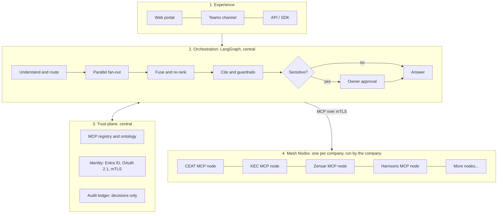
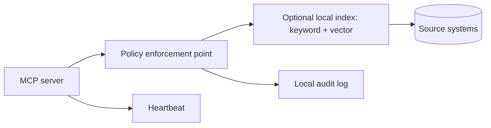
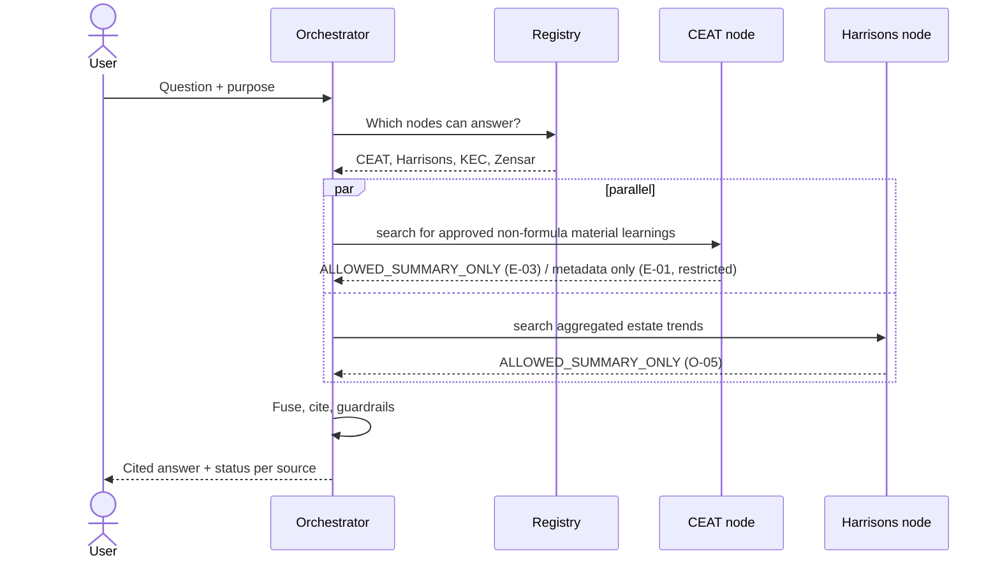
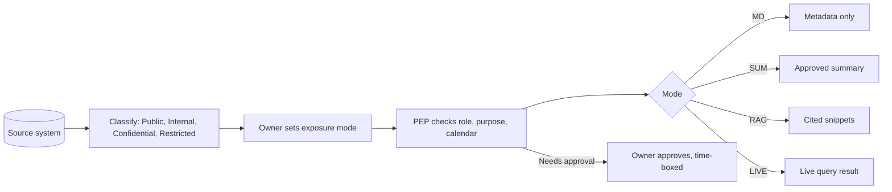

# RPG NeuralMesh: Design Plan

**Version 3.2.** Consistency fixes against wireframe v4_2, the MCP server plan and the knowledge-base pack. Changes are marked *(v3.2)*; see `RPG_NeuralMesh_POC_Consistency_Audit.md`.

**What it is:** a thin, secure agentic knowledge layer. A group user asks one plain-language, cross-domain question; one central LangGraph orchestrator routes it to subsidiary-owned MCP servers, combines policy-approved results, and returns a cited answer. Each subsidiary retains its source systems and controls its node. Source records are not migrated to a group data lake; only permitted metadata, summaries, or snippets cross a node boundary for a query.

**How to read this plan**

| Part | Answers | Wireframe screen |
|---|---|---|
| A. Architecture | What are the building blocks and why? | Admin, Mesh Nodes |
| B. High-level design | How does it behave, run and get adopted? | Dashboard, Ask, Expert Finder, Governance |
| C. Datapoints | What knowledge is exposed, by whom, how far? | Governance (exposure rules) |
| D. Traceability | How do use cases tie A, B and C together? | all |

**Evidence labels:** *Verified* = public source (Workstream 1). **(A)** = assumption, to validate. Sample figures are illustrative.

---

## Part A. Architecture

### A1. One-page view

Each company operates its own MCP server as a wrapper around its approved documents, SOPs, and structured-data connectors. Queries and retrieval stay local; a local index is optional and remains inside the company boundary. The server exposes the common tool contract below. The central orchestrator is the only coordinating agent; subsidiary nodes enforce policy and return bounded results rather than acting as independent orchestrators.

Inside every Mesh Node:

### A2. Components and recommended choices

| # | Component | Where it runs | Recommendation | Alternative and trade-off |
|---|---|---|---|---|
| 1 | Portal, Teams channel, API | Central | Web portal plus Teams | Slack or WhatsApp: weaker enterprise identity |
| 2 | Orchestrator | Central | **One LangGraph orchestrator**: plans and routes sub-queries, fans out to subsidiary MCP servers in parallel, fuses permitted results, cites claims, applies guardrails, and supports human approval | Host the same central orchestrator on Zensar's ZenseAI.AgentMesh: faster, but ties commercial rights to a group company |
| 3 | MCP registry and ontology | Central | Registry of nodes, capabilities and schema versions; group vocabulary mapping each company's terms to one concept | Per-node discovery: no shared vocabulary |
| 4 | Identity | Central | Entra ID SSO, OAuth 2.1 token exchange, mTLS between orchestrator and nodes | Separate identity per node: more upkeep |
| 5 | Audit ledger | Central plus local | Each node logs locally; central hash-chain stores decisions only, never content | Central content logs: breaks "data stays home" |
| 6 | **Mesh Node** | Company | One company-operated MCP server wrapping approved local documents, SOPs, and structured data; node-side PEP, optional local index, local audit, heartbeat | **Lite node** (managed bundle) for low-IT units; it remains a wrapper, not a central data store. Structured data is exposed only through allow-listed aggregate views with a minimum group size, never base tables *(v3.2)* |
| 7 | Models | Central and node | Approved group gateway by default; local model for sensitive nodes | Public APIs: not acceptable for Confidential data |
| 8 | Platform | Hybrid | Nodes run where the data lives; orchestrator in one group tenant; private connectivity | Full multi-cloud: later phase |

### A3. Node contract (the only interface between centre and node)

| MCP tool | Purpose | Returns |
|---|---|---|
| `describe_capabilities` | What can this node answer? | Domains, datapoint IDs, exposure modes |
| `search` | Query local knowledge under the caller's rights | Ranked snippets with source IDs; for structured data, a small aggregate table from an allow-listed view *(v3.2)* |
| `summarize` | Summary of a document or collection | Summary with citations |
| `find_experts` | Consent-based expert lookup | Role, skills, evidence |
| `request_access` | Raise an approval for restricted content (`kind: content`) or a consent-based expert introduction (`kind: intro`) *(v3.2)* | Request ID, approver |
| `health` | Heartbeat | Status, latency, schema version |

Decision codes returned by the PEP: `ALLOWED`, `ALLOWED_SUMMARY_ONLY`, `NEEDS_APPROVAL`, `BLOCKED_BY_POLICY`, `NODE_UNAVAILABLE`.

### A4. Architecture decisions

| ADR | Decision | Why | Main alternative |
|---|---|---|---|
| 1 | MCP is the only node contract | One standard, no custom integrations | REST per node |
| 2 | Policy is enforced **at the node**, not only the centre | A compromised centre cannot leak what the node refuses | Central policy only |
| 3 | Metadata first, content on approval | Discovery is open; access is earned | Open full-text |
| 4 | Every claim needs a citation | Trust and auditability | Free-form answers |
| 5 | Audit stores decisions, never content | Keeps data at home | Full content logs |
| 6 | Build vs buy for the orchestrator is decided before the pilot | Zensar already sells an agent-mesh product | Decide later |
| 7 | Structured data is exposed only through allow-listed aggregate views with a minimum group size *(v3.2)* | Gives live data without row-level exposure | Direct table access |
| 8 | An approval can raise exposure only up to the level the datapoint declares *(v3.2)* | Bounded, time-boxed upgrades | Open-ended grants |

---

## Part B. High-level design

### B1. Scope and outcomes

**In scope:** cross-company question answering, expert finding, node onboarding, approvals, audit, impact tracking. Any group user may ask, subject to identity, purpose, node policy, and data-owner approval; this does not mean unrestricted access to every subsidiary's content.
**Out of scope for now:** source-data migration, a central data lake, write-back to source systems, external customers. Local retrieval indexes may be built within a subsidiary boundary. Query-approved metadata, summaries, or cited snippets may cross to the orchestrator; raw source records and disallowed content do not.
**Outcomes:** faster cross-company problem solving, searchable institutional memory, a reusable framework for later commercialisation.

### B2. Who uses it

| Persona | Needs | Main screens |
|---|---|---|
| Engineer / PMO / strategy lead | Answers and experts | Ask, Expert Finder |
| Data owner (per company) | Control what leaves | Governance |
| Node owner and IT lead | Join and run a node | Mesh Nodes |
| Mesh Council, Group CDO | Value, adoption, rules | Dashboard, Admin |
| CISO, DPO, internal audit | Evidence | Governance (audit) |

### B3. Key flow: cross-company question

The L-02a approval flow is a separate integration-lessons scenario: the KEC node returns `NEEDS_APPROVAL`, and a time-boxed owner decision is handled through `request_access`. Other flows shown in the wireframe include denied access (blocked source stays visible with its reason), partial failure (a node is down; answer says so), and node onboarding (three-step wizard).

### B4. Security and compliance in one view

| Control | How |
|---|---|
| Who may ask | Entra ID SSO, role plus purpose on every query |
| What may leave | PEP at the node: sensitivity tier × exposure mode × purpose |
| Never leaves | Restricted data, UPSI, personal data, JV or partner IP, capped at metadata |
| Answer safety | PII redaction, prompt-injection and tool-poisoning checks, citation required |
| Listed companies | UPSI blackout calendar blocks finance data (five listed entities: CEAT, KEC, Zensar, RPG Life Sciences, Harrisons) |
| JV | Raychem stays at Wave 2 until TE Connectivity terms are agreed |
| Personal data | DPDP Act 2023: consent for the expert directory, data stays in HR systems |
| Cross-border | KEC's US, Mexico and Brazil operations: residency check per query |
| Proof | Hash-chained decision log, per-node kill switch |

### B5. Node maturity and adoption

| Level | Node can... | Effort | Start here |
|---|---|---|---|
| L0 Metadata | Publish catalogue entries | Days | Lite nodes |
| L1 Summaries | Add approved summaries, approved aggregate views and consent-based expert directory where opted in | 2-4 weeks | Harrisons, Ventures |
| L2 Retrieval | Retrieval over approved collections | 1-2 months | CEAT, KEC (target) |
| L3 Agentic | Live system queries and tools | 3+ months | Zensar (target) |

**Why a company joins:** it *receives* answers from peers, *gives* knowledge and gets credit, and *owns* the exposure decision. The onboarding kit (container, connectors, policy templates, tests) keeps the effort to days for a lite node.

### B6. Deployment and non-functional targets

| Area | Target (to validate in pilot) |
|---|---|
| Answer time | Median under 10 s, p95 node response under 300 ms |
| Availability | 99.5% for the orchestrator; a node outage degrades the answer, never blocks it |
| Cost | Metered per query, shown back to each company |
| Operations | Traces, token and cost metering, per-node health, DR for the central plane only |

### B7. Pilot and roadmap

| Phase | Scope | Exit test |
|---|---|---|
| **Pilot, about 12 weeks** | CEAT, KEC, Zensar, Harrisons; UC1-UC4 plus UC7. Harrisons joins at L1; CEAT exposes E-03 approved non-formula summaries, while restricted E-01 formulations remain metadata-only. | At least 60% of answers rated useful; median time-to-answer down; zero policy breaches; CEAT-Harrisons query returns citations without exposing formulations or row-level estate data |
| **Scale** | Add RPG Life Sciences, Raychem, RPG Ventures; deepen node maturity and datapoint coverage by owner approval | All companies live; approvals under 24 h |
| **Commercialise** | Package orchestrator, node kit, policy engine | Group approves a business case |

**ROI logic:** benefit = questions per week × share useful × minutes saved × loaded hourly cost, less run cost. The wireframe uses 55% useful, 40 minutes and ₹1,500 per hour as placeholders. Pilot data replaces them.

### B8. Top risks

| Risk | Mitigation |
|---|---|
| Companies will not maintain nodes | Lite node, kit, showback, council recognition |
| Sensitive leakage | Metadata-first modes, PEP at node, red-team tests, kill switch |
| JV and UPSI conflicts | Hard-coded never-leave rules, blackout calendar |
| Overlap with Zensar's AgentMesh | Decide build vs buy and IP ownership first |
| Weak answers | Citations, eval sets, feedback loop |

---

## Part C. Datapoints

### C1. How a datapoint gets exposed

| Exposure mode | What crosses the boundary | Allowed for |
|---|---|---|
| **MD** metadata-only | Title, tags, owner, existence | Everything, including Restricted |
| **SUM** summary | Owner-approved summary | Internal, Confidential |
| **RAG** retrieval | Cited snippets | Public, Internal; Confidential with approval |
| **LIVE** live query | Result of a scoped query | Structured, low-risk data |

**Approval upgrade *(v3.2)*:** a datapoint may declare `upgrade_with_approval: RAG`. An owner grant can then raise exposure to that level for a limited time, never beyond it. Bodies for upgraded content sit in a gated store that is not searchable until a grant exists.

**Never leaves the company [NL]:** Restricted data, UPSI, personal data beyond consented expert fields, JV or partner IP (TE Connectivity), client-confidential material.

### C2. Catalogue (v1)

Systems are **(A)** unless noted. Verified: CEAT PLM and RUBY knowledge hub; KEC SAP S/4HANA programme. Value = cross-use value (H/M/L). Types: S structured, SS semi, U unstructured, X expert.

| ID | Company | Datapoint | Source | Type | Sensitivity | Exposure | Refresh | Owner role | Value |
|---|---|---|---|---|---|---|---|---|---|
| **Engineering** | | | | | | | | | |
| E-01 | CEAT | Compound formulations, material specs **[NL]** | PLM / RUBY (verified) | SS | Restricted | MD | Event | Head R&D | M |
| E-02 | CEAT | Test and field-failure reports, RCAs | PLM, QMS | U | Confidential | SUM; RAG after owner approval | Weekly | Head Quality | H |
| E-03 | CEAT | Approved non-formula materials handling and storage learnings; formulations excluded | PLM / RUBY / QMS (A) | U | Confidential | SUM | Event | Head R&D | H |
| E-04 | KEC | Tower design standards, type-test reports | Engineering DMS | SS | Confidential | SUM | Event | Head Engineering | H |
| E-05 | KEC Cables | Cable and elastomer test data | LIMS | SS | Confidential | SUM | Event | Cables CTO | H |
| E-06 | Raychem | Accessory designs, qualification reports **[NL]** (TE IP) | PLM, test lab | SS | Restricted | MD | Event | CTO | M |
| E-07 | RPG LS | API process development, validation **[NL]** | QMS, eDMS | SS | Restricted | MD | Event | Head Tech Ops | L |
| **Operations** | | | | | | | | | |
| O-01 | CEAT, KEC (pilot); Raychem, RPG LS (later) | Maintenance and breakdown RCAs | CMMS | SS | Internal | RAG | Daily | Plant maintenance | H |
| O-02 | CEAT, KEC (pilot); others later | HSE incidents, anonymised | HSE system | SS | Confidential | SUM | Event | Head HSE | H |
| O-05 | Harrisons | Aggregated yield, tapping, weather, disease and latex-spoilage trends; no row-level estate or worker data in pilot output | Estate MIS | SS | Internal | SUM (owner-approved aggregate views, minimum 3 estates) | Seasonal | GM Estates | H |
| O-06 | KEC | Site progress and delay notes | Planning tool, SAP PS | SS | Confidential | SUM | Weekly | PMO head | H |
| **Commercial** | | | | | | | | | |
| C-01 | KEC | Bid prices and strategy **[NL]** | Bid tool | U | Restricted | MD | Event | Bid head | M |
| C-02 | All | Contract-clause and claims precedents | CLM | U | Confidential | SUM | Event | General Counsel | H |
| C-03 | CEAT | Channel pricing **[NL]** | SAP, DMS | S | Restricted | MD | Monthly | CMO | L |
| C-05 | Zensar | AI-native delivery playbooks | KM portal | U | Internal | RAG | Quarterly | CTO office | H |
| C-06 | RPG LS | Licensed market data **[NL]** | Third-party feed | S | Restricted | MD | Monthly | Marketing head | L |
| **R&D and innovation** | | | | | | | | | |
| R-01 | All | Patent and FTO register | IP system | SS | Confidential | MD | Monthly | IP counsel | M |
| R-02 | Zensar (pilot); CEAT, KEC, Raychem (later) | Pilot and experiment results, including failures (client names masked) | Lab notebooks | U | Confidential | SUM | Event | R&D heads | H |
| R-03 | RPG Ventures | Startup pipeline and diligence memos | Deal CRM | SS | Confidential | SUM | Weekly | Head of Ventures | H |
| **Corporate functions** | | | | | | | | | |
| F-01 | All | Policies and SOPs | Intranet | U | Internal | RAG (SUM at L1 nodes such as Harrisons) | Event | Policy owners | M |
| F-02 | All | Litigation and title-dispute files **[NL]** | Matter system | U | Restricted | MD | Event | General Counsel | L |
| F-04 | All | Expert directory (consent-based) | HRMS | S | Confidential | LIVE | Daily | CHRO | H |
| F-05 | KEC (pilot); others later | ESG metrics (water and energy), aggregates over at least three plants | ESG platform | S | Internal | LIVE | Quarterly | ESG head | M |
| F-06 | Listed companies | Finance and capex benchmarks, pre-results **[NL]** (UPSI) | ERP, BI | S | Restricted | MD | Quarterly | CFO | M |
| **Lessons learned (institutional memory)** | | | | | | | | | |
| L-01 | CEAT | Camso integration playbook and post-mortems | PMO documents | U | Confidential | SUM | Milestone | Integration lead | H |
| L-02 | KEC | SAE Towers integration post-mortem | PMO documents | U | Confidential | SUM | Milestone | PMO head | H |
| L-02a | KEC | Post-mortem annex: claims and labour (full text) | PMO documents | U | Confidential | RAG, needs approval | Milestone | PMO head | H |
| L-03 | RPG LS | API-plant fire RCA and restoration, anonymised | HSE, QMS | U | Confidential | SUM | Event | Head Operations | H |
| **Mesh meta-datapoints** | | | | | | | | | |
| M-01 | Mesh | Catalogue entries and lineage | Registry | S | Internal | LIVE | Event | Node owner | H |
| M-02 | Mesh | Access policies and decisions | Policy store | S | Confidential | MD | Event | Node owner, CISO | H |
| M-03 | Mesh | Query audit logs (decisions only) **[NL]** content | Local plus central hash | S | Restricted | MD | Live | CISO | H |
| M-04 | Mesh | Feedback, ratings, eval sets | Mesh database | S | Internal | LIVE | Event | Mesh team | H |

### C3. Coverage by company

| Company | Datapoint IDs | Node role |
|---|---|---|
| CEAT | E-01, E-02, E-03, C-03, F-06, L-01, O-01, O-02, F-04 (consent-based opt-in) | Pilot; E-01 stays MD-only |
| KEC International | E-04, E-05, O-01, O-02, O-06, C-01, C-02, L-02, L-02a, F-05, F-04 (consent-based opt-in) | Pilot |
| Zensar | C-05, F-04, R-02 (client work excluded) | Pilot |
| RPG Life Sciences | E-07, C-06, L-03, O-02 | Wave 2 |
| Raychem RPG | E-06, R-02, O-01 | Wave 2, after TE consent |
| Harrisons Malayalam | O-05, F-01, F-04 (consent-based opt-in) | Pilot L1; O-05 aggregate views and F-01 summaries only |
| RPG Ventures | R-03 | Lite node |

---

## Part D. Traceability: use cases tie it together

| Use case | Datapoints (C) | Nodes | Architecture parts (A) | Wireframe |
|---|---|---|---|---|
| **UC1** Expert finder | F-04, L-01, L-02 | Pilot nodes with opt-in participants | `find_experts`, consent in PEP | Expert Finder |
| **UC2** Integration lessons (Camso, SAE Towers) | L-01, L-02, L-02a, C-05 | CEAT, KEC, Zensar | `search`, `summarize`, approval flow | Ask, Governance |
| **UC3** Incident and RCA patterns | O-02, O-01, E-02, O-06 | CEAT, KEC | `search` on anonymised summaries and aggregate views; RPG LS L-03 is a scale extension | Ask |
| **UC4** AI delivery playbooks | C-05 | Zensar to all | `search` RAG mode | Ask |
| **UC5** Contract and claims precedents (next) | C-02 | KEC, Raychem, Zensar | Privilege rules in PEP | Ask |
| **UC6** Materials-science exchange (later) | E-02, E-05, R-02 | CEAT, KEC, Raychem | MD/SUM only; TE rules | Ask |
| **UC7** Materials learning to latex-spoilage prevention | E-03, O-05 | CEAT, Harrisons | LangGraph routes two sub-queries to local MCP servers; owner-approved SUM outputs only; E-01 formulations remain MD-only | Ask |

---

## Open questions for RPG

1. Who is the executive sponsor, and who sits on the Mesh Council?
2. Build the orchestrator, or host it on Zensar's AgentMesh? Who owns commercial rights?
3. What are the confirmed systems of record at each company?
4. What do TE Connectivity terms allow for Raychem?
5. Is there a group data-classification policy and UPSI protocol to inherit?
