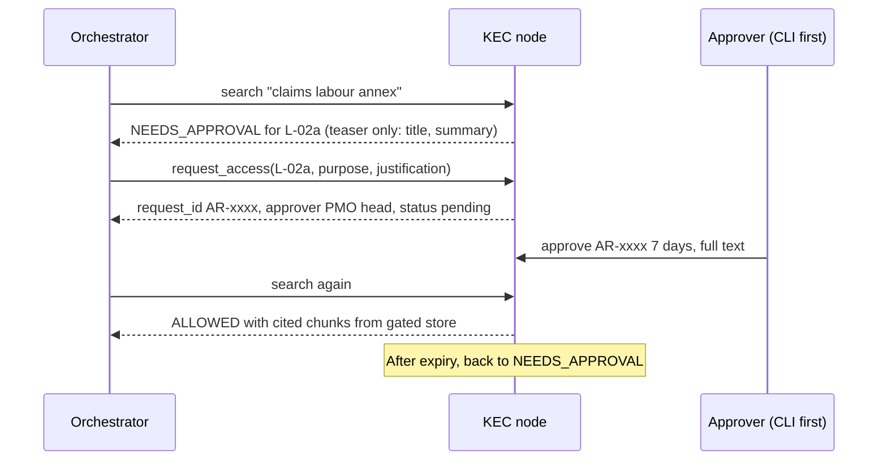

# RPG NeuralMesh: Subsidiary Knowledge Bases and MCP Server Plan

**Scope.** This document covers the layer *below* the orchestrator: the mock knowledge base for each subsidiary and a build plan for each MCP server. The orchestrator connection and the final wireframe wiring come next and reuse the `mesh_contract` described in `RPG_NeuralMesh_Implementation_Blueprint.md`.

**What you get with this.** `neuralmesh_kb_pack.zip` holds the hand-authored knowledge bases (`kb/*.yaml`), a generator (`kbgen.py`) and the generated `data_pack/`. I ran the generator here and its validation passes. All content is **synthetic**.

```
pip install pyyaml
python kbgen.py        # rebuilds data_pack/ from kb/*.yaml, then validates
```

---

## 1. The knowledge base pack at a glance

| Node | Port | Level | Docs | Index rows | Structured data | Experts (opted out) | Canaries |
|---|---|---|---|---|---|---|---|
| Harrisons Malayalam | 8104 | L1 | 10 | 10 | `estate_mis.db`: 12 estates × 36 months (432 rows) + 2 aggregate views | 4 (1) | 1 |
| CEAT | 8101 | L2 | 17 | 17 | `qms.db`: 60 failure reports, 80 maintenance rows | 5 (1) | 4 |
| KEC International | 8102 | L2 | 10 | 10 | `projects.db`: 30 projects, 90 delay notes | 5 (1) | 2 |
| Zensar | 8103 | L2 | 8 | 8 | none (wiki only) | 4 (1) | 0 |

This is a **seed set**: small enough to read, rich enough to test every rule. To scale it, add documents to `kb/<node>.yaml` and rerun the generator.

### What the generator guarantees (validation)

| Check | Why |
|---|---|
| Canary strings exist in `source/` or `gated/` but **never** in `index.db`, `policy.yaml` or public expert fields | Proves restricted text cannot be searched or leaked |
| Approval-gated bodies (KEC L-02a) live in `gated/`, not in the index | No ranking side channel from gated text |
| Each node has at least one opted-out expert | Consent test |
| Harrisons has small cells (21 month × time-band cells with fewer than 3 estates) | Suppression test |
| Pre-coagulation is the largest spoilage cause in every season | Keeps the summaries truthful to the data |
| Zensar injection page is present in the index | Guardrail test has something to catch |
| No emails or phone-like strings in public files | Hygiene |

### Numbers computed from the mock data (used inside summaries and gold facts)

| Node | Computed fact |
|---|---|
| Harrisons | Pre-coagulation share of spoilage: 71% in June-August vs 47% in December-February |
| Harrisons | Total spoilage: 3.6% of latex collected under 2.5 h to factory vs 5.3% over 3.5 h |
| Harrisons | Contamination steady, 0.77%-0.85% per month; temperature losses peak March-May at about 1.1% |
| CEAT | 18% of mock failure reports link to material handling |
| KEC | Top delay category: material-supply (31% of delay notes), then right-of-way |

The generator writes these into `data_pack/gold/facts.json`, so evals compare answers against numbers that really exist in the data.

---

## 2. Build order common to every server

All four servers share `node_core`. Build it once, against Harrisons first, then reuse.

| Milestone | Deliverable | Acceptance test |
|---|---|---|
| **M1** Skeleton | `build_server(cfg)` with `health` and `describe_capabilities`; Streamable HTTP; loads `node.yaml` and `policy.yaml` | MCP Inspector lists two tools; `describe_capabilities` returns datapoints from policy |
| **M2** Auth and caller context | JWT verification (mock IdP key), caller context (user, company, roles, purpose, trace ID, `as_of`) | Bad or missing token returns an error; context reaches handlers |
| **M3** Index and `search` | FTS5 query over `index.db`; query sanitiser; ranking by bm25; shaped result items and `withheld` items | Query returns ranked items with citations; no raw SQL from user text |
| **M4** PEP | The eight-step decision order from the blueprint, with a rule ID per outcome | Truth-table tests pass |
| **M5** Audit | Hash-chained JSONL (caller, datapoint IDs, decision, rule ID, trace ID; never content) | Tamper with one line and verification fails |
| **M6** Remaining tools | `summarize`, `find_experts`, `request_access` (with grants table), approval CLI | Grant, expiry and revocation tests pass |

### Cross-server rules (apply to all four)

* **Reindex test.** Implement `reindex()` that rebuilds the index from `source/`, `policy.yaml` and the connector, and assert it equals the shipped `index.db` row for row. This proves the exposure rules are implemented in code, not just baked into the pack.
* **Search query handling.** Strip FTS operators from user text, split into tokens, join with `OR`, cap length, and never interpolate user text into SQL.
* **Result shape.** Never return a body when `mode` is MD or SUM. `text` is the approved summary (SUM), a cited chunk (RAG), or absent (MD).
* **Stale flag.** Pass `stale: true` for documents with a version year before 2021 so the orchestrator can warn.
* **No node-side LLM** in this phase. Approved summaries are authored in the knowledge base.
* **Errors.** Return structured decisions, not stack traces. A refusal always carries `rule_id`.

---

## 3. Server 1: Harrisons Malayalam (build first)

**Why first:** smallest scope, the aggregate-view idea is the most distinctive security feature, and it is half of your flagship question.

### 3.1 Knowledge base

| Datapoint | Sensitivity | Ceiling | Documents in the pack |
|---|---|---|---|
| **O-05** Aggregated latex-spoilage and estate trends | Internal | SUM | `O-05-01` seasonal pattern, `O-05-02` time-band effect, `O-05-03` cause mix, `O-05-04` **gap: no lot-level quality trending at receipt** |
| **F-01** Estate SOPs | Internal | RAG | `F-01-01` collection and cups, `-02` anticoagulant dosing, `-03` transport and receipt, `-04` contamination control, `-05` monsoon procedure |
| **F-02** Title-dispute file | Restricted | MD, never leaves | `F-02-01` (canary in body, not indexed) |
| **F-04** Expert directory | Confidential | LIVE, consent | 4 experts (agronomist, factory processing, estate operations, quality supervisor who has opted out) |

**Why O-05-04 matters.** It is the hook that lets the orchestrator connect CEAT's lot-level quality trending to a real Harrisons gap, so the answer is specific rather than generic.

### 3.2 Connector design

| Part | Design |
|---|---|
| Base data | `estate_mis.db` table `estate_month` (estate, month, collected kg, rainfall, transport hours, spoilage kg by four causes, workers). **Never queried by the server** |
| Exposed data | Views `v_spoilage_by_month` (month, cause, spoilage %, estate count) and `v_spoilage_by_band` (month, time band, spoilage %, estate count). Both have `HAVING COUNT(DISTINCT estate_id) >= 3` |
| Connector API | `aggregate(view, month_from, month_to)` allows only the two view names from an allow-list. Used later for LIVE answers; in this phase summaries are prebuilt |
| Guard | A unit test parses every SQL string the connector executes and fails if it mentions `estate_month` or `workers` |

### 3.3 Tool behaviour

| Tool | Behaviour |
|---|---|
| `search` | Query `index.db`. O-05 results return the approved summary (SUM). F-01 results return cited chunks (RAG). F-02 title appears in `withheld` with rule `R-NL-02` |
| `summarize` | Returns the approved summary for the document; refuses F-02 |
| `find_experts` | Returns experts with consent, role, skills and evidence; never `private.name` |
| `request_access` | For `kind=intro`, creates a pending intro request; the approver's grant reveals the name |
| `health`, `describe_capabilities` | As in the common build |

### 3.4 Tests and planted traps

| Test | Expectation |
|---|---|
| Query "latex spoilage monsoon" | O-05-01 first; citation label shows "Harrisons O-05 (approved aggregate)" |
| Query "estate worker names" | No row-level data; nothing from base tables |
| Query "title dispute" | F-02-01 in `withheld` only; canary absent everywhere |
| Small cells | The 21 suppressed month × band cells never appear in any output |
| Expert query | Opted-out expert absent; name not returned before grant |
| SQL guard | Connector never touches `estate_month` |

**Definition of done:** M1-M6 pass for Harrisons; S1 Harrisons-side responses match section 8; contract tests green. **Estimate:** 3-4 days after `node_core` exists.

---

## 4. Server 2: CEAT

### 4.1 Knowledge base

| Datapoint | Sensitivity | Ceiling | Documents in the pack |
|---|---|---|---|
| **E-03** Approved materials handling and storage learnings (non-formula) | Confidential | SUM | `E-03-01` lot acceptance and trending, `-02` warehouse storage, `-03` contamination and moisture control, `-04` supplier feedback loop, `-05` time-to-use and traceability, `-06` **legacy 2019 note (stale)** |
| **E-02** Test and field-failure reports and RCAs | Confidential | SUM | `E-02-01` material-handling-linked defects (18%), `-02` blister and void causes |
| **L-01** Camso integration playbook | Confidential | SUM | `L-01-01` first 100 days (early systems integration), `-02` distribution and retention post-mortem |
| **O-01** Maintenance RCAs | Internal | RAG | `O-01-01` mixer bearing wear, `-02` curing press steam traps |
| **O-02** HSE incidents (anonymised) | Confidential | SUM | `O-02-01` forklift near-misses |
| **E-01** Formulations and specs | Restricted | MD, never leaves | `E-01-01`, `-02` (canaries in body, not indexed) |
| **F-06** Pre-results finance benchmarks | Restricted | MD, UPSI blackout | `F-06-01` |
| **C-03** Channel pricing | Restricted | MD, never leaves | `C-03-01` |
| **F-04** Experts | Confidential | LIVE, consent | 5 experts (1 opted out) |

### 4.2 Connector design

| Part | Design |
|---|---|
| Documents | Folder connector over `source/`; front matter gives datapoint, sensitivity, version |
| Structured | `qms.db` tables `failure_reports` and `maintenance_log`. Phase 1 uses them only to compute the 18% statistic at build time; later a LIVE aggregate (counts by root-cause category) can be added behind the same allow-list pattern as Harrisons |
| Plant labels | `PL-1` to `PL-6` only, so no real plant is implied |
| Calendar | `results_calendar.yaml` window 15 Oct to 14 Nov 2026 (mock results window). Today falls inside it, so F-06 is blocked in the demo |

### 4.3 Tool behaviour

| Tool | Behaviour |
|---|---|
| `search` | E-03 returns approved summaries. A query containing "compound" or "formulation" matches E-01 titles only, so E-01 appears in `withheld` with `R-NL-01`. F-06 appears in `withheld` with rule `UPSI` while `as_of` is in the window |
| `summarize` | Approved summary only; refuses E-01, C-03, F-06 |
| `find_experts` | Consent filter; the polymer scientist (opted out) never appears |
| `request_access` | Allowed for E-02 full text (creates approval, owner Head Quality). Refused for never-leave datapoints with no approval path |

### 4.4 Tests and planted traps

| Test | Expectation |
|---|---|
| S1 CEAT side: "natural rubber storage handling contamination lot acceptance" | E-03-01 to -05 returned; E-03-06 flagged `stale`; E-01 listed under `withheld` |
| S5: "compound formulation for tread compounds" | `BLOCKED_BY_POLICY`, rule `R-NL-01`, metadata only; `CANARY-CEAT-FORMULA-7731` appears nowhere |
| S6: "pre-results capex benchmarks" | Blocked with rule `UPSI`; with `as_of=2026-12-01` the item is still MD-only because the datapoint is never-leave |
| Conflict | L-01-01 (early systems integration) is returned so the orchestrator can show the conflict with Zensar |
| Canary scan | All four canaries absent from responses, audit logs and traces |

**Definition of done:** S1, S5, S6 CEAT-side responses match; stale flag works; contract tests green. **Estimate:** 3 days.

---

## 5. Server 3: KEC International

### 5.1 Knowledge base

| Datapoint | Sensitivity | Ceiling | Documents in the pack |
|---|---|---|---|
| **L-02** Overseas integration post-mortem | Confidential | SUM | `L-02-01` first 100 days (process ownership before cut-over), `-02` mobilisation: labour, contracts, payment cycles |
| **L-02a** Claims and labour annex (full text) | Confidential | RAG **with approval** | `L-02a-01` body in `gated/` (canary) |
| **O-06** Site progress and delay notes | Confidential | SUM | `O-06-01` delay pattern: material-supply 31% |
| **E-04** Tower design standards | Confidential | SUM | `E-04-01` |
| **E-05** Cable and elastomer tests | Confidential | SUM | `E-05-01` elastomer ageing faster when stored warm or long |
| **C-02** Contract precedents | Confidential | SUM | `C-02-01` liquidated damages, `-02` payment terms |
| **C-01** Bid prices | Restricted | MD, never leaves | `C-01-01` (canary) |
| **F-05** ESG practices | Internal | SUM | `F-05-01` water practices |
| **F-04** Experts | Confidential | LIVE, consent | 5 experts (1 opted out) |

**Cross-node link.** `E-05-01` says elastomers age faster when stored warm or long. That supports CEAT's storage and time-to-use learnings from a second company, which gives the orchestrator corroborating evidence.

### 5.2 Connector design

| Part | Design |
|---|---|
| Documents | Folder connector; the gated store connector reads `gated/` only when a valid grant exists |
| Structured | `projects.db` (`projects`, `delay_notes`). Phase 1 uses it to compute the delay statistic; a LIVE aggregate by category can follow |
| Grants | `grants` table in `grants.db`: request ID, caller, datapoint, mode, status, approver, `expires_at` |

### 5.3 Approval flow (the important part of this server)



### 5.4 Tests and planted traps

| Test | Expectation |
|---|---|
| Before grant | L-02a returns `NEEDS_APPROVAL`; body and canary absent |
| After grant | Chunks returned with citation; audit entry records grant ID |
| After expiry | Back to `NEEDS_APPROVAL` |
| Wrong caller | A grant for one user does not apply to another |
| Revoked grant | Immediately blocked |
| C-01 | `withheld` only; `CANARY-KEC-BID-8801` never appears |
| `CANARY-KEC-CLAIMS-4410` | Never appears without a grant; never in logs even with a grant (audit logs decisions, not content) |

**Definition of done:** S2 KEC-side flow works end to end including approve and expire; grant tests green. **Estimate:** 3 days.

---

## 6. Server 4: Zensar

### 6.1 Knowledge base

| Datapoint | Sensitivity | Ceiling | Documents in the pack |
|---|---|---|---|
| **C-05** Delivery and integration playbooks | Internal | RAG | `C-05-01` 100-day checklist (**stabilise processes before cut-over**), `-02` transition playbook, `-03` AI-assisted delivery, `-04` tooling consolidation, `-99` **onboarding page with a planted injection** |
| **R-02** Pilot results (client masked) | Confidential | SUM | `R-02-01` AI-assisted testing, `-02` support knowledge assistant |
| **F-01** Policies | Internal | RAG | `F-01-01` responsible AI usage |
| **F-04** Experts | Confidential | LIVE, consent | 4 experts (1 opted out) |

### 6.2 Connector design

| Part | Design |
|---|---|
| Documents | Markdown wiki folder connector. RAG chunks are paragraph-based, 600 characters maximum |
| Injection handling | The node returns the text as stored. It is the **orchestrator's guardrail** that strips or flags instruction-like text. The node adds a `suspicious: true` flag if a simple pattern matches ("ignore previous instructions"), as a defence in depth |
| Client masking | `R-02` summaries are pre-masked in the knowledge base; a unit test scans for client-name patterns |

### 6.3 Tests and planted traps

| Test | Expectation |
|---|---|
| Query "100-day integration checklist" | C-05-01 chunks with citations |
| Query "onboard new joiners" (S8) | C-05-99 may be retrieved; node flags `suspicious: true`; the injected instruction must not change behaviour downstream (verified in the orchestrator phase) |
| Conflict | C-05-01 (stabilise first) vs CEAT L-01-01 (integrate early): both retrievable |
| R-02 | Summaries only, no client names |

**Definition of done:** S2 and S8 Zensar-side responses match; contract tests green. **Estimate:** 2 days.

---

## 7. Cross-server contract test suite

Run the same suite against all four nodes. A node that fails does not register.

| Test group | Checks |
|---|---|
| Discovery | `describe_capabilities` lists every datapoint in policy; `tool_hash` stable across restarts |
| Search shape | Each result has `doc_id`, `datapoint_id`, `mode`, `sensitivity`, `citation`; MD/SUM results never include body text |
| Refusals | Every `withheld` item has `rule_id` and a reason |
| Leak | Canary list from the pack is absent from every response and from `audit.jsonl` |
| Consent | Opted-out experts never returned; names hidden before a grant |
| Time | `as_of` inside and outside the calendar window changes UPSI behaviour |
| Resilience | Server handles malformed queries (very long, SQL-like, FTS operators, empty) without error |
| Audit | Chain verifies; tampering is detected |
| Reindex | `reindex()` reproduces the shipped `index.db` |

### Ports and config summary

| Node | Port | Pack folder | Structured DB | Owner role for approvals |
|---|---|---|---|---|
| CEAT | 8101 | `data_pack/ceat` | `qms.db` | Head Quality / Head R&D |
| KEC | 8102 | `data_pack/kec` | `projects.db` | PMO head |
| Zensar | 8103 | `data_pack/zensar` | none | CTO office |
| Harrisons | 8104 | `data_pack/harrisons` | `estate_mis.db` (views only) | GM Estates |

---

## 8. Handoff to the orchestrator (what it should see)

When all four nodes pass, the orchestrator work starts. These are the node responses it should be able to rely on for your flagship scenario.

**S1: "What rubber-compound learnings from CEAT could reduce Harrisons Malayalam's latex spoilage?"**

| Node | Sub-query the orchestrator sends | Expected node response |
|---|---|---|
| CEAT | Natural-rubber storage, handling, contamination and lot-acceptance learnings; non-formula | `ALLOWED_SUMMARY_ONLY`: E-03-01..05 (and E-03-06 flagged stale); `withheld`: E-01-01, E-01-02 (`R-NL-01`) |
| Harrisons | Spoilage drivers by season and handling time; current gaps | `ALLOWED_SUMMARY_ONLY`: O-05-01..04; RAG chunks from F-01 SOPs |
| KEC (optional) | Elastomer ageing and storage | E-05-01 corroborates the storage and time-to-use point |

**What a good answer contains (from the gold facts):**

1. Spoilage is driven mainly by pre-coagulation (71% of spoilage in June-August) and by longer time to factory (3.6% vs 5.3%).
2. CEAT's transferable practices: lot-level quality trending, time-to-use and traceability, contamination and moisture control at receipt, a supplier feedback loop.
3. Harrisons' stated gap: no lot-level quality trending at receipt, which CEAT's practice addresses directly.
4. What does **not** transfer: formulations (withheld), and the difference between dry rubber storage and wet latex handling.
5. No canary string anywhere.

---

## 9. Later nodes (outline only)

| Node | Datapoints | Notes |
|---|---|---|
| RPG Life Sciences | L-03 anonymised fire RCA (SUM), O-02 (SUM), E-07 process development (MD, never leaves) | Stress-tests the policy engine with regulated content |
| Raychem RPG | E-06 designs (MD, TE IP, never leaves), O-01, R-02 | Blocked by default until partner terms are agreed; use it to demonstrate a JV rule |
| RPG Ventures | R-03 startup pipeline (SUM) | Lite node; shows "new node = config + data" |

Add each by writing `kb/<node>.yaml`, a port, and a connector, then running the contract suite.

---

## 10. Suggested order and effort (assumptions)

| Step | Days |
|---|---|
| `node_core` M1-M6 against Harrisons | 5-7 |
| Harrisons hardening and tests | 1-2 |
| CEAT | 3 |
| KEC with approvals | 3 |
| Zensar | 2 |
| Contract suite and chaos tests across nodes | 2 |
| **Total before orchestrator work** | **about 16-19 days for one engineer** |

## Open questions

1. Do you want the pack scaled up (for example 40-70 documents per node) before building, or build on the seed set first and scale during evals? I would build on the seed set.
2. Who approves mock content so it cannot be mistaken for real RPG data?
3. Should the approval CLI exist in this phase, or should approvals be seeded in the database until the Governance screen is wired?
